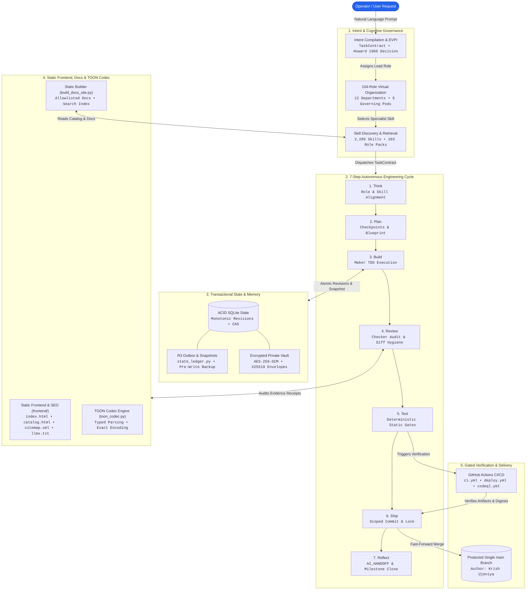

<p align="center">
  
</p>

<h1 align="center">AGYOS</h1>

<p align="center">
  <strong>Autonomous Cognitive Operating System for AGY CLI</strong>
</p>

<p align="center">
  <a href="LICENSE"></a>
  <a href="https://agyos.pages.dev"></a>
</p>

AGYOS is an autonomous operating system and multi-agent execution kernel for AGY CLI. It is built for solopreneurs, independent operators, and autonomous agent swarms to plan, build, review, test, and ship software under strict engineering invariants.

The system combines a Python cognitive decision kernel (`gemini/antigravity-cli/builtin/agyos_decision/`), a static documentation and catalog portal (`frontend/`), and a Node.js MCP state server (`gemini/antigravity-cli/mcp/state-server.cjs`) with an enterprise organization of 104 operational roles across 12 departments, 2,289 TOON-native skills across 103 role packs, 109 agent definitions, 148 modular rules, and an automated 7-step cycle (`Think -> Plan -> Build -> Review -> Test -> Ship -> Reflect`).

---

## One-Line Install (`~/.gemini`)

Sync `AGYOS/gemini/` (`config/` and `antigravity-cli/`) into `~/.gemini/` (automatically creates a timestamped backup of `~/.gemini` first):

```bash
curl -fsSL https://raw.githubusercontent.com/krishujeniya/AGYOS/main/gemini/antigravity-cli/builtin/scripts/install.sh | bash
```

Or from a local clone:

```bash
git clone https://github.com/krishujeniya/AGYOS.git && cd AGYOS && make install
```

---

## Architecture



---

## Core Components

| Component | Path | Responsibility |
|:---|:---|:---|
| **Decision Kernel** | `gemini/antigravity-cli/builtin/agyos_decision/` | Intent compilation, Howard 1966 EVPI, 104-role matrix, TOON codec/compiler, and 7-step cycle |
| **CLI Dispatcher** | `gemini/antigravity-cli/bin/agyos` | Unified CLI entry point across routing, TOON skills, verification, and lifecycle |
| **MCP Daemon** | `gemini/antigravity-cli/mcp/state-server.cjs` | Zero-dependency stdio JSON-RPC 2.0 server exposing state, memory, and TOON skill search |
| **Frontend Portal** | `frontend/` | Static documentation portal, skill catalog UI, and SEO files (`sitemap.xml`, `robots.txt`, `llms.txt`) |
| **Scripts & CI** | `gemini/antigravity-cli/builtin/scripts/` | Site/catalog builders, TOON validators, security scanners, benchmarks, and state-store tests |
| **Deployment** | `deploy/` | Docker containerization manifests (`deploy/docker/`) alongside root `wrangler.jsonc` |

---

## The 7-Step Autonomous Cycle

1. **Think:** Compiles natural language intent into a typed `TaskContract`, computes Howard 1966 EVPI for clarification, assigns the lead role, and identifies specialist skill runbooks.
2. **Plan:** Produces architectural blueprints, acceptance criteria, task breakdowns, and structured milestone checkpoints.
3. **Build:** Executes Maker TDD (RED -> GREEN -> REFACTOR) complying with production invariants.
4. **Review:** Independent Checker audit for code quality, secret leakage, OWASP Top 10 vulnerabilities, and git hygiene.
5. **Test:** Remote static and integration verification via GitHub Actions (`ci.yml`).
6. **Ship:** Delivery to the single `main` branch under verified author identity after passing all gates.
7. **Reflect:** Logs structured handoffs, updates `gemini/antigravity-cli/builtin/state/CURRENT.md` and milestone checkpoints, and records durable memory.

---

## 104-Role Organization Matrix

AGYOS models an enterprise organization partitioned into 12 functional departments and governed by 5 operational pods:

- **`pod-build`** (43 roles): Engineering, Architecture, Systems Design, DevOps, QA, and Infrastructure.
- **`pod-growth`** (21 roles): Marketing Strategy, Conversion Rate Optimization, Content Creation, and Sales Pipeline.
- **`pod-customer`** (8 roles): Customer Success, Support Operations, Client Onboarding, and Account Management.
- **`pod-gna`** (27 roles): Finance, Treasury, Legal Compliance, Risk Management, and Corporate Governance.
- **`pod-people`** (5 roles): Talent Acquisition, Human Resources, Compliance, and Learning & Development.

---

## Engineering Invariants

- **Single `main` Branch Exclusive:** All development lands strictly on `main`.
- **Identity Lock:** All commits are authored under `Krish Ujeniya <100012208+krishujeniya@users.noreply.github.com>`.
- **GitHub Actions Verification:** Full test suites, catalog builds, and security scans run in GitHub Actions (`ci.yml`, `codeql.yml`); local checks stay fast and loadless (`make typecheck`, `make lint`).
- **Mandatory `uv` for Python:** All Python package management and script execution uses `uv` (`uv run`, `uv pip`).
- **Bounded Working Sets:** Bounded telemetry ring buffers and pre-write snapshot caps (`16 MiB` max file snapshot size).
- **Zero Plaintext Secrets:** Zero hardcoded tokens or secrets; environment variables use startup redaction.

---

## Documentation

- [Developer Setup](docs/setup.md) — Prerequisites (`uv`, Node 22+), local loadless checks, and `Makefile` targets
- [System Architecture](docs/ARCHITECTURE.md) — 6-layer cognitive architecture, 5 pods, 104 roles, and EVPI/Saga controls
- [Skill Routing](docs/SKILL_ROUTING.md) — Discovery contract across the 2,289 TOON skills
- [Rules & Standards](docs/RULES.md) — Modular rule library (`gemini/antigravity-cli/builtin/rules/`) and precedence
- [Native Workflows](docs/NATIVE_WORKFLOWS.md) — Background multi-agent workflow scripts (`gemini/antigravity-cli/builtin/workflows/`)
- [Operations Runbook](docs/OPERATIONS_RUNBOOK.md) — SLOs, vault setup, compaction, and disaster recovery
- [Host Compatibility](docs/HOST_COMPATIBILITY.md) — Qualified interfaces and host verification limits
- [Deployment Guide](docs/deployment.md) — Cloudflare Pages (`agyos.pages.dev`) and Docker deployment

---

## License & Security

This project is licensed under the Apache License 2.0. See [`LICENSE`](LICENSE) for details.

Security policies and vulnerability reporting procedures are documented in [`.github/SECURITY.md`](.github/SECURITY.md).
