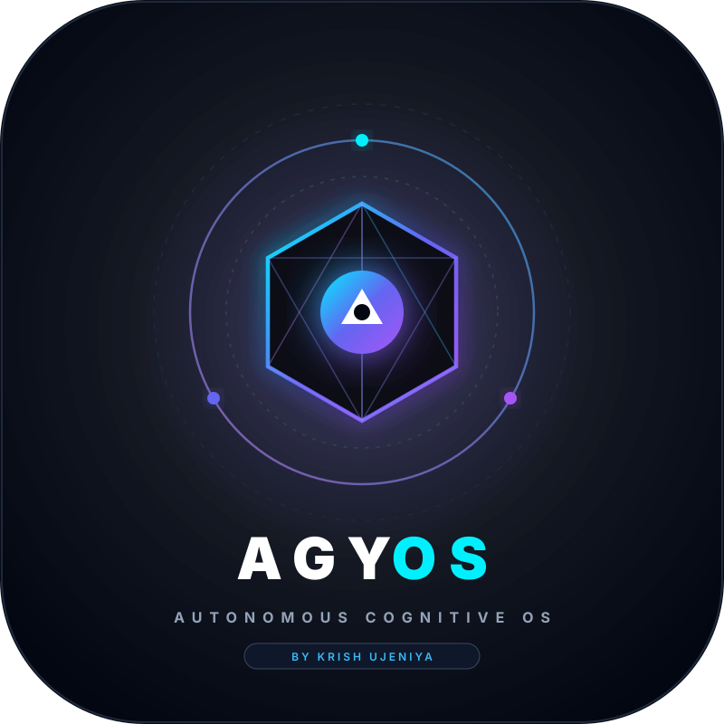
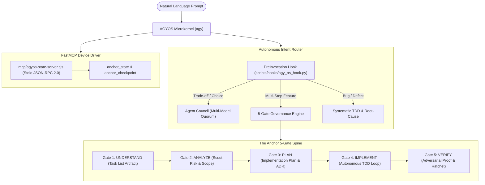

<p align="center">
  
</p>

<h1 align="center">AGYOS</h1>

<p align="center">
  <strong>The Autonomous Cognitive Operating System for AGY CLI</strong><br />
  <em>Enterprise-Grade 5-Gate Governance • Multi-Model Deliberation • 1,846 Pure Skills • Zero-Slash Automation</em>
</p>

<p align="center">
  <a href="LICENSE"></a>
  
  
  
</p>

---

## What is AGYOS?

AGYOS is an autonomous operating system built specifically for Google Antigravity CLI (`agy`). It wraps the agent runtime with deterministic 5-gate lifecycle governance, multi-model consensus, strict token economics, and progressive disclosure skills.

AGYOS replaces fragmented agent configurations with a single unified operating standard:
- **Zero Slash Commands**: Natural language prompt comprehension automatically routes tasks to the correct workflow without typing `/council`, `/anchor`, or `/plan`.
- **Silent Skill Ingestion (Anti-Meta Standard)**: AGYOS never outputs meta-announcements like *"I am loading skill X"*. It loads runbooks under the hood and delivers direct code changes and proof.
- **Autonomous Role Assumption**: Acts dynamically as Product Lead, Systems Architect, Lead Engineer, Security Auditor, and QA Lead across each milestone phase without manual role assignment.
- **Token-Optimized for Flash Models**: Structured for low latency and minimal token consumption on `gemini-3.8-flash-high`, `gemini-3.8-flash-medium`, and `flash_lite` as well as Claude thinking models.
- **No AI Slop**: Strict adherence to factual, direct human engineering language. Prohibits decorative emojis, AI boilerplate, and unverified claims.

---

## The 4 Engineering Pillars

```
+---------------------------------------------------------------------------------+
|                                    AGYOS CORE                                   |
+------------------------+------------------------+-------------------------------+
|  PROMPT ENGINEERING    |  CONTEXT ENGINEERING   |  GRAPH & HARNESS ENGINEERING  |
|  • CRISPE + Invariant  |  • 20k Token Budget    |  • AST Dependency Graphs      |
|  • Falsifiable Specs   |  • Progressive Paging  |  • Test Ratchet (Monotonic)   |
|  • Negative Bounds     |  • <24KB Rule Ceilings |  • 23-Point Adversarial Suite |
+------------------------+------------------------+-------------------------------+
```

1. **Prompt Engineering**: Every specification follows the CRISPE + Invariant framework (Capacity, Role, Grounding, Directives, Negative Constraints, Done Criteria).
2. **Context Engineering**: Strict enforcement of the 20,000-token rules budget (`defaultRulesBudget`). Rule files strictly respect the 24KB limit. Skills load lean YAML frontmatter by default; heavy documentation loads on demand from `references/`.
3. **Graph Engineering**: Context graphs in `.agents/state/context-graph.json` map AST hierarchies, import chains, and blast radius before any file mutation.
4. **Harness Engineering**: Autonomous TDD loops (RED ➔ GREEN ➔ IMPROVE), eval-driven validation, and a pre-commit Test Ratchet ensuring total test assertions never decrease.

---

## System Architecture



---

## The 8 Validated AGYOS Plugins

Packaged in `.agents/plugins/` and verified with `agy plugin validate`:

| Plugin Identifier | Domain | Core Capabilities |
| :--- | :--- | :--- |
| **`agyos-anchor`** | Governance | 5-Gate development spine, scope boundary jail, FastMCP server. |
| **`agyos-council`** | Deliberation | Multi-model CLI panel running Gemini, Claude, and Codex in parallel. |
| **`agyos-aegis`** | SDLC Architecture | 8 role agents (PM, Architect, Engineer, QA Lead, DevOps) & quality gates. |
| **`agyos-ecc-polyglot`** | Language Stacks | Idiomatic patterns for Rust, Go, Python, TS, Vue, Django, and PostgreSQL. |
| **`agyos-verification`** | Testing | Test-driven development (TDD), Playwright E2E testing, and test ratchets. |
| **`agyos-security`** | Defense | OWASP Top 10 auditing, secret scanners, and repository sanitization. |
| **`agyos-seo`** | Discovery | Technical SEO audits, Schema.org JSON-LD, sitemaps, and GEO answer engine citations. |
| **`agyos-business-creative`**| Operations & UI/UX | Client discovery, Statements of Work, Emil Kowalski design engineering, Framer Motion, and GSAP motion engines. |

---

## Directory Structure

```
AGYOS/
├── AGENTS.md                          # AGYOS Constitution, Invariants & FAANG Corporate Model
├── GEMINI.md -> AGENTS.md             # Automatic discovery link
├── AI_HANDOFF.md                      # Runtime handoff, active task & verification records
├── assets/
│   ├── agyos-logo.svg                 # AGYOS Master Vector Logo
│   └── README.md                      # Visual brand assets specification
├── bin/
│   ├── agyos                          # Central AGYOS CLI utility
│   ├── gate-check.sh                  # Pre-commit test ratchet enforcer
│   ├── state.sh                       # Atomic state access layer
│   ├── state-validate.sh              # State self-healing engine
│   ├── compact.sh                     # Context compaction utility
│   └── rollback.sh                    # Milestone rollback utility
├── mcp/
│   ├── agyos-state-server.cjs         # FastMCP State Server for AGY CLI
│   ├── README.md                      # MCP server specification & JSON-RPC docs
│   └── examples/contra-mcp-starter/   # Example MCP server development package
├── docs/
│   ├── index.html                     # Web catalog interface (GitHub Pages)
│   ├── skills-data.json               # Compiled skills dataset
│   ├── ai-catalog.json                # Discovery metadata
│   ├── assets/                        # Documentation logos & social previews
│   └── references/                    # Specifications, PDFs & Prompt engineering library
│       ├── prompts.md                 # CRISPE + Invariant production prompt library
│       ├── github-profile-playbook.pdf# Technical portfolio engineering guide
│       └── Motion_Graphics_Google_Flow_Master_Guide.pdf # Motion timing guide
├── scripts/
│   ├── agyos-init.sh                  # Universal zero-config bootstrapper
│   ├── agyos-verify.sh                # 23-point adversarial test runner
│   ├── package_agyos_plugins.py       # Plugin packager with logos & rules
│   ├── build_docs_data.py             # Skill catalog compiler & unslop filter
│   └── hooks/agy_os_hook.py           # Real-time lifecycle interceptor
├── .agents/
│   ├── hooks.json                     # Real-time lifecycle bus
│   ├── skills.json                    # Progressive disclosure manifest
│   ├── plugins.json                   # Active plugin manifest
│   ├── state/                         # State machine (state.json, CURRENT.md)
│   ├── rules/                         # 140 modular rules (<24KB each)
│   ├── workflows/                     # 100 autonomous workflows
│   ├── agents/                        # 74 specialized role agents
│   ├── skills/                        # 1,846 consolidated physical skills
│   └── plugins/                       # 8 validated AGYOS plugins
├── skills -> .agents/skills           # Direct visible access to 1,846 skills
├── rules -> .agents/rules             # Direct visible access to 140 rules
└── workflows -> .agents/workflows     # Direct visible access to 100 workflows
```

---

## Quickstart & Verification

```bash
# Initialize and validate AGYOS in this workspace
bin/agyos init

# Execute the 23-point adversarial machine test suite
bin/agyos verify

# Inspect current milestone and active gate
bin/agyos state

# Deliberate on an architectural tradeoff via multi-model council
bin/agyos council "Should we use PostgreSQL or ClickHouse for event analytics?"
```

---

## License

Apache-2.0. Maintained by [Krish Ujeniya](https://github.com/krishujeniya).
