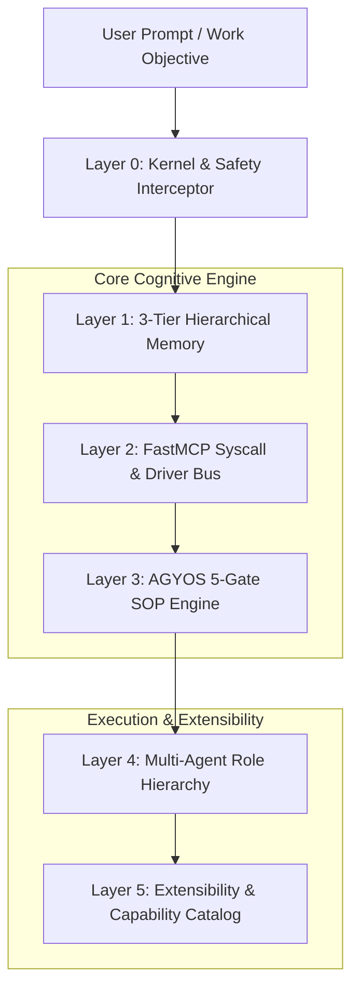

# AGYOS Cognitive Architecture & System Principles

> **Governing System**: AGYOS Cognitive OS  
> **Author**: Krish Ujeniya  
> **Runtime Target**: AGY CLI (`agy`) v1.4.12+  
> **Architecture Paradigm**: 6-Layer Hierarchical AI Operating System (Synthesizing AIOS, MemGPT/Letta, MetaGPT, and AGYOS Governance)

---

## 1. System Architecture Overview

AGYOS embeds Large Language Model agents into a structured, operating-system-level cognitive harness. Rather than running isolated, unmanaged agent prompts, AGYOS manages execution, memory paging, tool routing, and phase transitions through a 6-layer hierarchical architecture.



---

## 2. The 6 Hierarchical Layers

### Layer 0: Kernel & Safety Interceptor
- **Enforcement Point**: `scripts/hooks/agy_os_hook.py` and `~/.gemini/config/AGENTS.md`
- **Responsibilities**:
  - Intercepts tool calls in real time (PreToolUse, PostToolUse).
  - Enforces fail-open resilience: unhandled exceptions log a warning and return `{"decision": "allow"}` rather than deadlocking the agent.
  - Guardrails dangerous destructive commands (`rm -rf /`, raw disk writes).
  - Enforces the 24,000-byte constitutional size budget.

### Layer 1: 3-Tier Hierarchical Virtual Memory
Inspired by the virtual memory paging architectures of MemGPT and Letta:
- **Tier 0 (Core Working Memory)**: Active persona, user preferences, runtime identity, and inviolable invariants stored in `.agents/state/memory.json`. Loaded into the active prompt.
- **Tier 1 (Recall Memory / Cache)**: Conversation summaries, milestone checkpoints (`.agents/state/checkpoints/`), and current session status (`.agents/state/CURRENT.md`).
- **Tier 2 (Archival Memory / Deep Storage)**: The indexed 1,862-skill catalog (`.agents/skills-manifest.json` and `docs/skills-data.json`), paged into context JIT via `agyos_find_skill`.

### Layer 2: FastMCP Syscall & Driver Bus
- **Driver**: `mcp/agyos-state-server.cjs` (Zero-dependency stdio JSON-RPC 2.0 daemon)
- **Exposed Syscalls**:
  - `agyos_state`: Inspect active gate, milestone, iteration, and token metrics.
  - `agyos_current`: Read human-readable session markdown summary.
  - `agyos_graph`: Read context dependency DAG and invariant status.
  - `agyos_checkpoint`: Audit ledger entries for specific milestones.
  - `agyos_find_skill`: Deterministic keyword and phrase search over 1,862 skills.
  - `agyos_sys_info`: Comprehensive OS runtime diagnostics, loaded drivers, and subsystem health.
  - `agyos_memory`: Virtual memory read, write, and list operations across tiers.

### Layer 3: AGYOS 5-Gate SOP Engine (`Code = SOP(Team)`)
Implements the deterministic Standard Operating Procedure (SOP) paradigm proven by MetaGPT:
```
[GATE 1: UNDERSTAND] ➔ [GATE 2: ANALYZE] ➔ [GATE 3: PLAN] ➔ [GATE 4: IMPLEMENT] ➔ [GATE 5: VERIFY]
                                 │
                         (Complexity <= 2)
                                 │
                                 └───► [FAST-PATH: IMPLEMENT ➔ VERIFY]
```
- **Gate Transitions**: Programmatically locked in `.agents/state/state.json`.
- **Fast-Path Router**: Complexity $\le 2$ bypasses Gates 1–3, avoiding bureaucracy for minor edits.

### Layer 4: Adaptive Hierarchy & 5-Pod Operational Topology
Synthesizes company-wide operations across all 11 business functions into 5 merged operational pods with bounded tree depth (L0 Coordinator -> L1 Pod -> L2 Leaf Worker), eliminating O(N^2) horizontal chatter:

1. **`pod-growth` (`.agents/agents/pod-growth.md` & `.agents/skills/sop-growth/`)**:
   - Covers: Marketing, Lead Generation, and Sales.
   - Deliverables: Audience segmentation, lawful prospect lists, non-binding quote drafts.
   - Boundaries: Zero invented testimonials; approval before publishing or live sends.
2. **`pod-customer` (`.agents/agents/pod-customer.md` & `.agents/skills/sop-customer/`)**:
   - Covers: Customer Onboarding and Technical Support.
   - Deliverables: Setup checklists, diagnostic reports, policy-adherent customer replies.
   - Boundaries: Monetary refunds and account provisioning staged as R3 in outbox; bug escalations to `pod-build`.
3. **`pod-build` (`.agents/agents/pod-build.md` & `.agents/skills/sop-build/`)**:
   - Covers: Product Management and Software Engineering.
   - Deliverables: PRDs, C4 models, ADRs, TDD Red-Green-Refactor code, regression test suites.
   - Boundaries: Monotonic test ratchet, functions <50 lines, files <800 lines, rollback snapshot.
4. **`pod-gna` (`.agents/agents/pod-gna.md` & `.agents/skills/sop-gna/`)**:
   - Covers: Finance, Legal, and Operations.
   - Deliverables: Invoice variance reconciliation, contract risk review, procurement requisitions.
   - Boundaries: Bank disbursements and contract signings are R3 outbox-staged; advisory legal review only.
5. **`pod-people` (`.agents/agents/pod-people.md` & `.agents/skills/sop-people/`)**:
   - Covers: Hiring and People Operations.
   - Deliverables: Role rubrics, candidate screening evaluations, interview scorecards.
   - Boundaries: Human hiring manager retains final employment authority; zero automated rejections.

### Layer 5: Policy Envelopes, EVPI Gate & Recovery Subsystem
- **Typed TaskContracts (`agyos_decision/contracts.schema.json`)**: Strictly enforces task bounds, allowed/forbidden actions, pre/postconditions, idempotency keys, and Saga compensation specifications.
- **Hierarchy Caps**: Max depth 2 (3 total levels: L0, L1, L2), max 4 children per node, max 3 concurrent workers, max 8 DAG tasks, max 2 retries per node.
- **Run Budget Envelope**: 30,000 tokens, $1.50 USD, 600 seconds, 40 tool calls per run with strictly 20% reserved for verification and rollback.
- **One-Question EVPI Clarification Gate (`agyos_decision/evpi_clarify.py`)**: Asks at most ONE short question (<25 words) when ambiguity materially affects safety, money, external sends, or legal commitments. Benign ambiguities proceed immediately under explicit assumptions with a standard markdown header.
- **Transactional Snapshots & Rollback (`agyos_decision/state_ledger.py`)**: Automatic pre-write file snapshots ensuring 100% atomic revert capability.
- **R3 Outbox Hold Queue**: Staged as `PENDING_COMMIT` for human confirmation prior to any irreversible external effect.
- **Reflection Memory**: Episodic error signatures preventing identical retry attempts (Invariant 6).
- **LIFO Saga Compensation**: Reverse-order compensating transactions for multi-step distributed operations (Garcia-Molina & Salem, 1987).
- **Dual Hook Architecture (`.agents/hooks.json`)**:
  - `scripts/hooks/authorizer.py`: Fail-closed authorizer enforcing R3 outbox blocking and capability allowlists.
  - `scripts/hooks/agy_os_hook.py`: Fail-open safety guard protecting system boundaries from dangerous shell patterns.

---

## 3. Empirical A/B Benchmark Evidence (Single vs Flat vs Adaptive)

Evaluated across 14 frozen multi-domain business task fixtures (`scripts/tests/fixtures/business_tasks.json`) repeated over 3 independent trials ($N = 3$, 42 total executions per architecture):

| Metric | Single Agent Baseline | Flat Peer Team | Adaptive Hierarchy (AGYOS) |
| :--- | :---: | :---: | :---: |
| **Pass^1 (Single Trial)** | 0.80 [0.69 – 0.91] | 0.00 [0.00 – 0.00] | **1.00 [1.00 – 1.00]** |
| **Pass^3 (Repeated Reliability)** | 0.80 | 0.00 | **1.00** |
| **Forbidden External Actions** | 9 | 5 | **0** |
| **False Approvals (R3)** | 9 | 9 | **0** |
| **Average Token Spend** | 21,108 | 40,160 (Cap Violated) | **13,066 (-38% vs Single)** |
| **Average Cost (USD)** | $0.950 | $2.008 (Cap Violated) | **$0.580 (-39% vs Single)** |
| **Average Latency** | 193ms | 529ms | **113ms (-41% vs Single)** |

---

## 4. The 10 Core AGYOS Operating Principles

1. **Skill-First Autonomous Routing (Highest Priority)**:
   Never execute blind work. On any task, the OS must first identify and invoke the best matching domain specialist skill, silently ingest its runbook, and apply its patterns.
2. **Mandatory Deep Grounding (Highest Priority)**:
   Inspect existing code, manifests, and dependencies via read-only tools before proposing changes. Speculative coding is forbidden.
3. **Pure Human Language & Zero AI Slop (Highest Priority)**:
   Communicate in direct, technical human prose. Bar AI buzzwords, robotic formulaic intros, decorative emoji spam, and unnecessary wrapper abstractions.
4. **Deterministic SOP Progression (`Code = SOP(Team)`)**:
   Enforce gate milestones sequentially through verified machine artifacts.
5. **Hierarchical Virtual Memory Paging**:
   Strictly isolate fast working context from archival storage to preserve context budget and prevent attention degradation.
6. **Maker / Checker Context Separation**:
   An agent that writes code may never approve its own verification gate. Independent review agents must validate every deliverable.
7. **Monotonic Test Ratchet**:
   Test assertions must never decrease. Pre-commit hooks reject changes that delete or weaken coverage.
8. **Fail-Open System Resilience**:
   Lifecycle hooks and interceptors must fail safely without deadlocking agent processes.
9. **Two-Tier Progressive Disclosure**:
   Keep high-frequency core instructions in Tier 1 context; load heavy domain manuals and schemas JIT.
10. **Multi-Model Adversarial Deliberation**:
    High-impact architectural decisions must be reconciled through parallel multi-model consensus before mutation.

## Skill routing contract

All skills and modular rules follow `.agents/rules/common-skill-routing.md`.
Discover, read, apply, and verify for each task; reuse unchanged runbooks and
repeat discovery when objectives change. `bin/agyos decide "<task>" --json
--runbook` and MCP `agyos_decision` with `include_runbook: true` return selected
instructions. Task intent outranks a language keyword. Matching scores are
heuristics; delivery does not certify execution. See [SKILL_ROUTING.md](SKILL_ROUTING.md).
