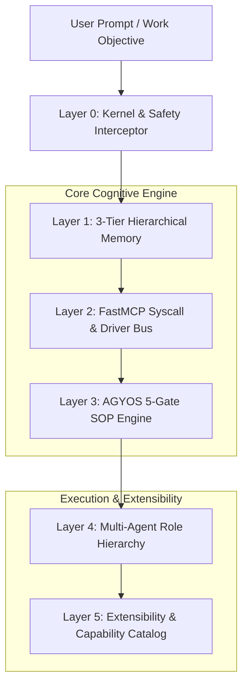

# AGYOS Cognitive Architecture & System Principles

> **Governing System**: AGYOS Cognitive OS  
> **Author**: Krish Ujeniya  
> **Runtime Target**: AGY CLI (`agy`) v1.4.12+  
> **Architecture Paradigm**: 6-Layer Hierarchical AI Operating System (Synthesizing AIOS, MemGPT/Letta, MetaGPT, and AGYOS Governance)

---

## 1. System Architecture Overview

AGYOS embeds Large Language Model agents into a structured, operating-system-level cognitive harness. Rather than running isolated, unmanaged agent prompts, AGYOS manages execution, memory paging, tool routing, and phase transitions through a 6-layer hierarchical architecture.



---

## 2. The 6 Hierarchical Layers

### Layer 0: Kernel & Safety Interceptor
- **Enforcement Point**: `scripts/hooks/agy_os_hook.py` and `~/.gemini/config/AGENTS.md`
- **Responsibilities**:
  - Intercepts tool calls in real time (PreToolUse, PostToolUse).
  - Enforces fail-open resilience: unhandled exceptions log a warning and return `{"decision": "allow"}` rather than deadlocking the agent.
  - Guardrails dangerous destructive commands (`rm -rf /`, raw disk writes).
  - Enforces the 24,000-byte constitutional size budget.

### Layer 1: 3-Tier Hierarchical Virtual Memory
Inspired by the virtual memory paging architectures of MemGPT and Letta:
- **Tier 0 (Core Working Memory)**: Active persona, user preferences, runtime identity, and inviolable invariants stored in `.agents/state/memory.json`. Loaded into the active prompt.
- **Tier 1 (Recall Memory / Cache)**: Conversation summaries, milestone checkpoints (`.agents/state/checkpoints/`), and current session status (`.agents/state/CURRENT.md`).
- **Tier 2 (Archival Memory / Deep Storage)**: The indexed 1,842-skill catalog (`.agents/skills-manifest.json` and `docs/skills-data.json`), paged into context JIT via `agyos_find_skill`.

### Layer 2: FastMCP Syscall & Driver Bus
- **Driver**: `mcp/agyos-state-server.cjs` (Zero-dependency stdio JSON-RPC 2.0 daemon)
- **Exposed Syscalls**:
  - `agyos_state`: Inspect active gate, milestone, iteration, and token metrics.
  - `agyos_current`: Read human-readable session markdown summary.
  - `agyos_graph`: Read context dependency DAG and invariant status.
  - `agyos_checkpoint`: Audit ledger entries for specific milestones.
  - `agyos_find_skill`: High-speed multi-token semantic search over 1,842 skills.
  - `agyos_sys_info`: Comprehensive OS runtime diagnostics, loaded drivers, and subsystem health.
  - `agyos_memory`: Virtual memory read, write, and list operations across tiers.

### Layer 3: AGYOS 5-Gate SOP Engine (`Code = SOP(Team)`)
Implements the deterministic Standard Operating Procedure (SOP) paradigm proven by MetaGPT:
```
[GATE 1: UNDERSTAND] ➔ [GATE 2: ANALYZE] ➔ [GATE 3: PLAN] ➔ [GATE 4: IMPLEMENT] ➔ [GATE 5: VERIFY]
                                 │
                         (Complexity <= 2)
                                 │
                                 └───► [FAST-PATH: IMPLEMENT ➔ VERIFY]
```
- **Gate Transitions**: Programmatically locked in `.agents/state/state.json`.
- **Fast-Path Router**: Complexity $\le 2$ bypasses Gates 1–3, avoiding bureaucracy for minor edits.

### Layer 4: Virtual Corporate Role Hierarchy (Vibe-to-FAANG Autonomous Operating Model)
Empowers non-technical operators and rapid vibe coders to build at the level of top-tier FAANG/MANGO engineering organizations:
- **Staff Product VP / PM** (Gate 1): Requirement synthesis, user stories, acceptance criteria, PRD generation, and out-of-scope boundaries.
- **Principal Systems Architect (`faang-architect`)** (Gate 2–3): Architecture Decision Records (ADRs), C4 system models, database schema indexing, and failure blast radius containment.
- **Staff Vibe-to-Production Engineer (`vibe-engineer`)** (Gate 3–4): Translates ambiguous conversational prompts into rigorous technical contracts, TDD test suites, and clean polyglot patterns.
- **Staff Software Engineer / Senior Maker** (Gate 4): High-velocity TDD Red-Green-Refactor, immutability, small functions (<50 lines), cohesive files (<800 lines).
- **Vibe Code Auditor (`vibe-code-auditor`)** (Gate 4–5): Audits generated code across 7 production dimensions, eradicates swallowed errors, removes dead code, and checks input validation.
- **Principal Security Engineer** (Gate 5): Threat modeling (STRIDE), OWASP Top 10 mitigation, zero-secret leak checks, and automated penetration testing (`pentagi-orchestrator`).
- **Design Engineering Specialist**: Enforces Emil Kowalski UI invariants (concentric radii $R_{inner} = R_{outer} - padding$, 60fps compositor motion, tactile micro-interactions).
- **Staff QA & Verification Lead** (Gate 5): Monotonic test ratchet enforcement, adversarial verification, and machine evidence generation.

### Layer 5: Extensibility & Capability Catalog
- **8 Validated Plugins**: Modular packages installed directly into AGY CLI (`agyos-governance`, `agyos-council`, `agyos-polyglot`, `agyos-verification`, `agyos-business-creative`, `agyos-security`, `agyos-seo`, `agyos-core`).
- **1,844 Physical Skills**: Comprehensive catalog of domain specialists indexed in `.agents/skills-manifest.json` and `docs/skills-data.json`.
- **AGYOS Decision Engine**: Calibrated System 1 skill router (`bin/agyos decide`) and FastMCP daemon (`agyos_decision`).
- **Agent Council**: Multi-model consensus panel running Gemini, Claude, and Codex in parallel via Bun.

---

## 3. The 10 Core AGYOS Operating Principles

1. **Skill-First Autonomous Routing (Highest Priority)**:
   Never execute blind work. On any task, the OS must first identify and invoke the best matching domain specialist skill, silently ingest its runbook, and apply its patterns.
2. **Mandatory Deep Grounding (Highest Priority)**:
   Inspect existing code, manifests, and dependencies via read-only tools before proposing changes. Speculative coding is forbidden.
3. **Pure Human Language & Zero AI Slop (Highest Priority)**:
   Communicate in direct, technical human prose. Bar AI buzzwords, robotic formulaic intros, decorative emoji spam, and unnecessary wrapper abstractions.
4. **Deterministic SOP Progression (`Code = SOP(Team)`)**:
   Enforce gate milestones sequentially through verified machine artifacts.
5. **Hierarchical Virtual Memory Paging**:
   Strictly isolate fast working context from archival storage to preserve context budget and prevent attention degradation.
6. **Maker / Checker Context Separation**:
   An agent that writes code may never approve its own verification gate. Independent review agents must validate every deliverable.
7. **Monotonic Test Ratchet**:
   Test assertions must never decrease. Pre-commit hooks reject changes that delete or weaken coverage.
8. **Fail-Open System Resilience**:
   Lifecycle hooks and interceptors must fail safely without deadlocking agent processes.
9. **Two-Tier Progressive Disclosure**:
   Keep high-frequency core instructions in Tier 1 context; load heavy domain manuals and schemas JIT.
10. **Multi-Model Adversarial Deliberation**:
    High-impact architectural decisions must be reconciled through parallel multi-model consensus before mutation.
