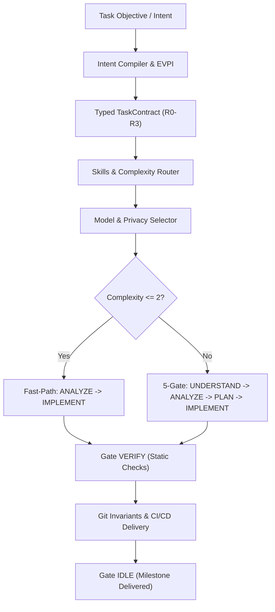

# AGYOS End-to-End Autonomous Pipeline

## 1. Overview

The AGYOS End-to-End Autonomous Pipeline (`bin/agyos e2e` / `agyos_pipeline`) provides a deterministic, zero-manual-command execution loop for engineering tasks. It translates natural language intent into typed contracts, selects domain specialist skills, scores complexity, manages lifecycle gates, executes static verification, and coordinates remote CI/CD delivery under strict identity locks.

## 2. Architecture and Data Flow



## 3. Core Lifecycle Stages

### Stage 1: Intent Compilation and EVPI Assessment
- **Function**: Parses unstructured input across 11 company functions and routes to one of 5 merged pods (`pod-growth`, `pod-customer`, `pod-build`, `pod-gna`, `pod-people`).
- **Risk Classification**: Classifies risk tier from `R0` (read-only) to `R3` (external irreversible).
- **EVPI Clarification**: For `R3` actions (fund transfers, mass deletion, broadcasts), holds execution in `PENDING_COMMIT` and asks at most one targeted question. For benign tasks (`R0`/`R1`), applies explicit safe defaults and marks `proceed_immediately=True`.

### Stage 2: Specialist Skill and Complexity Routing
- **Skill Discovery**: Evaluates the AGYOS physical skill catalog and selects the highest-scoring runbook.
- **Complexity Assessment**: Computes complexity score (1-5). Tasks scoring 1 or 2 are flagged for fast-path execution. Tasks scoring 3 or higher follow the full 5-gate lifecycle.
- **Model Routing**: Selects optimal model tier (`flash`, `standard`, `reasoning`) and enforces privacy boundaries.

### Stage 3: Gate Progression and State Hygiene
- **Atomicity**: Uses file locks (`flock`) on `.agents/state/state.json.lock` to prevent concurrency races.
- **Checkpoints**: Writes milestone audit logs to `.agents/state/checkpoints/<milestone-id>.md` copying exact skill versions.
- **Session Continuity**: Continuously regenerates `.agents/state/CURRENT.md` with structured handoff context.

### Stage 4: Static Verification
- Verifies Python compile sanity via `python3 -m compileall`.
- Validates shell entrypoints with `bash -n`.
- Enforces whitespace and patch hygiene via `git diff --check`.
- Records machine verification verdict in `state.json`.

### Stage 5: Remote CI/CD Delivery
- **Single Branch Exclusive**: Rejects non-`main` branches; enforces `main` exclusively.
- **Identity Lock**: Verifies `user.name "Krish Ujeniya"` and verified GitHub email attribution.
- **Remote CI Run**: Pushes directly to `origin main` and tracks GitHub Actions CI workflows.
- **Reset to IDLE**: Sets active gate to `IDLE` upon verified CI pass.

## 4. Interfaces

### CLI Interface
```bash
# Generate plan and contract without mutating state
bin/agyos e2e "optimize postgres connection pool" --action plan --json

# Initialize milestone and transition gates to IMPLEMENT
bin/agyos e2e "optimize postgres connection pool" --action init

# Run static checks and transition to VERIFY
bin/agyos e2e "optimize postgres connection pool" --action verify

# Commit, push to origin main, and transition to IDLE
bin/agyos e2e "optimize postgres connection pool" --action deliver --auto-push --watch-ci

# Complete autonomous lifecycle
bin/agyos e2e "fix typo in README" --action full --auto-push
```

### FastMCP Server Tool (`agyos_pipeline`)
Agents interacting via AGY CLI or MCP call the `agyos_pipeline` tool:

```json
{
  "name": "agyos_pipeline",
  "arguments": {
    "prompt": "implement structured logging in payment gateway",
    "action": "plan"
  }
}
```

Returns structured JSON containing `task_id`, `pod`, `risk`, `complexity_score`, `fast_path`, `skill`, `model`, `evpi`, and `contract`.
