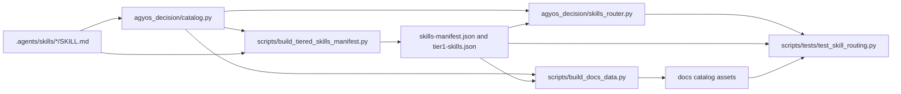

# AGYOS skill catalog quality and organization plan

## Goal and boundary

Improve discovery, correctness, structure, routing, references, and current catalog documentation. The approved audit baseline held 1,982 skills; the operator later expanded the scope to add a source-backed OpenWhispr skill. Preserve the flat `.agents/skills/` root and existing public IDs unless a rename has a clear user benefit and a tested compatibility path. Do not delete skills, touch global `~/.claude` data or unrelated application code, or alter pre-existing worktree edits.

The approved task list is `docs/SKILL_CATALOG_UPGRADE_TASK_LIST.md`; the dependency snapshot is `.agents/state/context-graph.json`. The full scout findings and verification limits remain in the task list. The exact ID `android_ui_verification` is a naming-style outlier, but the router and frozen cases depend on it and no search benefit has been shown. Preserve it unless implementation research proves a safe compatibility alias is worthwhile.

## Dependency map



The operator adopted three graph invariants during Gate 3: each skill directory has one matching, actionable runbook; primary runbooks stay below 300 lines with detail in local references; generated catalogs cover every physical skill once, with Tier 1 a subset.

## Ordered implementation batches

### Batch 1 — Add deterministic catalog-quality checks

Create `scripts/audit_skill_catalog.py` as a read-only report over direct physical skills. Cover YAML/frontmatter validity, directory/name agreement, duplicate IDs, actionable descriptions, full-file line limits, local Markdown targets, and duplicate-body groups. Keep heuristic findings labeled as candidates; do not treat keyword scans as confirmed defects.

Create `scripts/tests/test_skill_catalog.py` for analyzer behavior and repository-wide contracts. Extend `scripts/tests/test_skill_routing.py` only where routing fixtures or generated-index consistency need additional regression cases. Preserve every existing assertion. Run the new checks against the complete catalog and record baseline results before making skill edits.

### Batch 2 — Repair discovery metadata and structural defects

Update only verified defective headers in `.agents/skills/*/SKILL.md`: the 20 generic placeholder descriptions, malformed or duplicate frontmatter, slug-only/JSON-fragment descriptions, and any other confirmed unusable trigger descriptions. Keep each skill's name equal to its existing directory. Fix confirmed local links and triage the broader path scan against actual Markdown link syntax before editing.

For each runbook above the 300-line ceiling, move complete detailed sections into one or more skill-local `references/` files and replace them with a short operational entrypoint that links to those references. Preserve all instructions and code examples. Work in bounded groups and rerun link and frontmatter checks after each group. Do not truncate large files or mechanically split mid-section.

### Batch 3 — Correct confirmed content and resolve overlap safely

Fix high-confidence code/content defects first, including the Python-vs-Node mismatch in `elite-python-architect`, the mismatched Azure Key Vault client examples, and the undefined `call_ai_model` reference in `audio-transcriber`. Check each changed skill against its local references and dependent examples.

Review all exact and near-duplicate groups semantically. Record Keep or Improve decisions; do not merge or delete catalog entries in this milestone. Verify flagged legal, health, PCI, security, and current platform/API claims against current primary sources when possible. If a claim cannot be checked, qualify it or mark its freshness as unverified in the skill; do not restate it as confirmed.

Do not rename an ID based on style alone. If a concrete rename defect is established, first create an old-ID-to-new-ID map, trace every path and router/index reference, implement compatibility behavior, and add regression cases. No rename is currently approved by the available evidence.

### Batch 4 — Stabilize routing, generated catalogs, and current documentation

Add frozen router cases for this catalog-maintenance request and close paraphrases so they select the catalog/skill-maintenance workflow consistently. Keep the router conservative when intent is ambiguous. Update only current count claims in `README.md`, `AGENTS.md`/`GEMINI.md`, `.agents/skills/AGENTS.md`, `docs/index.html`, `docs/ARCHITECTURE.md`, and the in-scope self-improvement skill. Preserve dated historical counts.

Regenerate `.agents/skills-manifest.json`, `.agents/tier1-skills.json`, `docs/skills-data.json`, `docs/ai-catalog.json`, `docs/llms.txt`, `docs/sitemap.xml`, and `docs/robots.txt` using the repository generators. Change generator logic only when a reproducible defect is demonstrated.

### Batch 5 — Full-catalog verification and independent review

Re-inventory all direct skill IDs, metadata, descriptions, file lengths, local Markdown links, duplicate decisions, and generated index membership. Confirm that the manifest and docs catalog each cover every physical skill exactly once and Tier 1 remains a subset. Run the focused and full repository checks, inspect the complete task diff while excluding pre-existing changes, and request an independent reviewer before closing the milestone.

## Exact planned files

| Path | Planned role |
| --- | --- |
| `docs/SKILL_CATALOG_UPGRADE_PLAN.md` | This approved implementation sequence and file map. |
| `.agents/state/context-graph.json` | Scoped dependency relationships confirmed from imports and generator paths, plus the three operator-adopted invariants. |
| `scripts/audit_skill_catalog.py` | New deterministic, read-only full-catalog quality report. |
| `scripts/tests/test_skill_catalog.py` | New analyzer and whole-catalog regression checks. |
| `scripts/tests/test_skill_routing.py` | Add catalog-intent routing and generated-index regression cases. |
| `agyos_decision/catalog.py` | Modify only if a catalog contract defect is exposed by the tests. |
| `agyos_decision/skills_router.py` | Modify only for a demonstrated routing defect. |
| `scripts/build_tiered_skills_manifest.py` | Modify only for a reproduced manifest-generation defect or approved tier correction. |
| `scripts/build_docs_data.py` | Modify only for a reproduced documentation-generation defect. |
| `.agents/skills/*/SKILL.md` and `.agents/skills/*/references/**` | Correct confirmed metadata/content/link defects and split detailed material without loss. |
| `.agents/skills-manifest.json`, `.agents/tier1-skills.json` | Regenerated catalog outputs. |
| `docs/skills-data.json`, `docs/ai-catalog.json`, `docs/llms.txt`, `docs/sitemap.xml`, `docs/robots.txt` | Regenerated documentation outputs. |
| `README.md`, `AGENTS.md`, `GEMINI.md`, `.agents/skills/AGENTS.md`, `docs/index.html`, `docs/ARCHITECTURE.md`, `site/index.html`, `TRACKER.md`, `docs/security/THREAT_MODEL.md` | Correct current skill counts and catalog guidance; label historical baselines and preserve dated evidence. The 2026-11-11 user follow-up expanded the docs reconciliation to these current-facing surfaces. |
| `.agents/skills/openwhispr/SKILL.md` | Add the user-requested, source-backed OpenWhispr desktop and MCP runbook; the request expands the approved skill-catalog scope. |
| `.agents/state/corrections/CORRECTIONS_LOG.md`, `.agents/state/corrections/SESSION_SUMMARY.md` | Record the new skill and its verification status under the repository's self-improvement protocol. |
| `AI_HANDOFF.md`, `.agents/state/CURRENT.md`, `.agents/state/state.json`, `.agents/state/checkpoints/M1-skill-catalog-quality.md`, `docs/SKILL_CATALOG_UPGRADE_TASK_LIST.md` | Maintain the milestone record, approvals, verification evidence, and next command. |

The OpenWhispr skill is an explicit 2026-11-11 user-approved scope extension. Other files remain in scope only for concrete defects within the catalog and documentation boundary. Any rename map will be added only if a rename is justified and approved.

## Verification commands

Run the relevant focused checks after each batch, then run the final set below. Commands that are host-dependent must be reported as unavailable or unverified if their runtime prerequisites are missing.

```bash
python3 -B scripts/audit_skill_catalog.py
python3 -B -m unittest scripts.tests.test_skill_catalog scripts.tests.test_skill_routing -v
python3 scripts/build_tiered_skills_manifest.py
python3 scripts/build_docs_data.py
python3 -B -m unittest discover -s scripts/tests -v
bash scripts/agyos-verify.sh
bash bin/state-validate.sh
bash bin/gate-check.sh
bash .agents/skills/agyos-scout/scripts/scan-security.sh
git diff --check
```

The concrete demo command is `python3 -B scripts/audit_skill_catalog.py`; it must exit successfully and report zero unresolved structural violations, while separately listing any content freshness items that need a source or operator decision. Before final acceptance, compare regenerated outputs byte-for-byte on a second generator run and confirm the unrelated pre-existing worktree diff is unchanged.

## Operator-adopted graph invariants

1. Each direct skill directory has one `SKILL.md`; its first YAML header has a unique `name` equal to that directory and an actionable description.
2. A primary `SKILL.md` stays below 300 lines; detailed procedures live in linked skill-local references.
3. Every generated catalog contains each physical skill exactly once, and Tier 1 is a subset of the complete manifest.

The operator adopted these statements during Gate 3; they are recorded in `.agents/state/context-graph.json`.

## Execution status — 2026-11-11

- All 1,982 baseline IDs remain in the flat skill root; the OpenWhispr request added one ID, making the current catalog 1,983. No existing skill was deleted or renamed.
- 613 primary runbooks were moved below the 300-line ceiling. Independent comparison found 592 byte-identical source bodies after reversing link rewrites; 21 documented content, metadata, safety, or link corrections differ from baseline, with no unexplained truncation. Current inventory: 1,983 primary files, none at or above 300 lines.
- The read-only catalog auditor reports zero structural findings, zero duplicate descriptions, and zero exact duplicate-body groups. It reports 309 long-description review candidates, one retained noncanonical ID, and 7,657 freshness-keyword candidates; these heuristics are not confirmed content defects.
- Ten imported placeholder runbooks were replaced with source-informed procedures. All eight exact duplicate-body groups in the approved baseline were resolved while preserving IDs; six compatibility IDs now point to canonical guidance, five of them additional to the baseline groups. The hosted-agent runbook now reflects current Microsoft documentation.
- Added the source-backed `openwhispr` skill (version 1.0.2) with desktop setup, per-activity data-flow checks, distinct OAuth/API-key MCP guidance, and a frozen routing case. Generated indexes contain 1,983 skills (390 Tier 1 and 1,593 Tier 2).
- The focused catalog/router suite passed 41 tests. The unfiltered full suite ran 156 tests and returned three errors (the 60-second host CLI timeout and two subprocess integration errors); the host-skipped rerun passed 155 and skipped that host case. State validation, security scan, and deterministic generation passed. The final independent-review result and AGYOS wrapper evidence are recorded in `docs/SKILL_CATALOG_AUDIT_REPORT.md`.
- All 28 legacy Remotion Markdown rule files now contain only exact compatibility pointers to their canonical targets; the three TSX example assets remain byte-identical at both paths. Regression tests pin the full pointer contents and count.

## Plan-to-evidence reconciliation — 2026-11-11

| Batch | Status | Evidence and limits |
| --- | --- | --- |
| 1. Catalog checks and regression tests | Complete | Read-only scanner covers the current 1,983-skill catalog; structural findings are zero. Focused catalog/router suite: 41 passed. |
| 2. Discovery and structure | Complete | 613 long entrypoints moved to linked references; all primary runbooks are below 300 lines; confirmed broken links and metadata defects were corrected. No IDs were deleted or renamed. |
| 3. Content and overlap | Complete for confirmed findings | All eight exact duplicate-body groups from the approved baseline were resolved. Six compatibility IDs point to canonical guidance, including one ID in the baseline groups; five are additional alias cases. Ten imported placeholders were replaced with source-informed procedures. The 7,657 freshness-keyword matches and broader high-stakes claims remain unverified candidates, as recorded in the report. |
| 4. Routing, indexes, and current docs | Complete | Frozen routing cases, including OpenWhispr, pass; indexes cover 1,983 skills (390 Tier 1, 1,593 Tier 2); all eight generated artifacts were byte-identical across two runs. Current counts were reconciled across README, AGENTS, docs and site landing pages, tracker, generated indexes, and the threat-model inventory note. Dated historical snapshots remain labeled. |
| 5. Verification and independent review | Complete with documented runtime limits | Focused tests: 41 passed; full host-skipped suite: 155 passed, 1 skipped; filtered AGYOS wrapper: 51/51 with the same host test skipped. State validation and security scan passed. An unfiltered suite run recorded three errors and an unfiltered AGYOS wrapper run recorded the host CLI failure. Independent review closed the pointer, OpenWhispr, and metadata findings. See the audit report for exact output and limits. No commit, push, or deployment was performed. |
