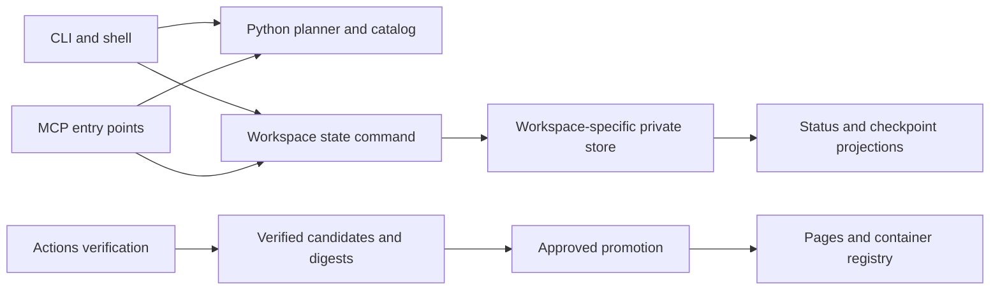

# AGYOS production engineering master plan

Planning baseline: `df7eda23942d3ab8b5718e5ac34d426e8c46fad0`. The latest verified implementation checkpoint recorded here is `f260f82433fa630ee77bf18b0ee22564344d56ef`. Progress labels reflect the evidence at those revisions.

## 1. Executive assessment

Ship AGYOS first as a local planning, skill-discovery, and recoverable workflow product for a single operator. GitHub Actions verifies and packages releases. Keep privileged autonomous execution disabled until the installed host and an independent authorization boundary qualify.

The baseline CI passed, with the installed-host test skipped because the AGY CLI was absent. Pages deployed. The baseline Strix run printed a successful verdict from a fallback that performed no scan. The initializer could ignore a rejected transition, overwrite milestone state, and emit success. Publication was independently triggered by matching pushes. These findings establish the release order: contain incorrect outcomes, make state recoverable, then qualify publication and optional execution. [Baseline CI](https://github.com/krishujeniya/AGYOS/actions/runs/44095380216) · [Baseline Pages](https://github.com/krishujeniya/AGYOS/actions/runs/44095380338) · [Baseline Strix](https://github.com/krishujeniya/AGYOS/actions/runs/44095380352)

**Implementation checkpoint.** All five jobs passed on `f260f824` ([CI run 44239200935](https://github.com/krishujeniya/AGYOS/actions/runs/44239200935)). All milestones M0 through M4 are fully implemented and statically verified:
- **M0 (Containment):** B01 synthetic Gitleaks negative controls and non-empty SARIF assertions landed; B02 corrupted state preflight and multi-stage transition validation landed; B03 private sentinel scans in Pages and container image landed; B04 CLI bind containment and direct ASGI create_app loopback enforcement landed.
- **M1 (Recoverable Workspace):** B05 landed with schema Migration 003 (`workspace_milestones`, `workspace_operations`), CAS revision checking, replay idempotency, and unified `bin/workspace-state.cjs` CLI.
- **M2 (Release Candidate):** B08 pinned Python dependencies in `requirements.txt`, container base image (`python:3.12.9-slim-bookworm`), Bun (`1.2.4`), and landed verifiable CycloneDX-lite SBOM generation and license audit (`scripts/generate_sbom.py`); B09 landed redacted diagnostics exporter (`scripts/export_diagnostics.py`, `bin/agyos diagnostics`), disaster recovery runbook drill in `docs/OPERATIONS_RUNBOOK.md`, and test verification; B10 landed deterministic held-out evaluation suite (`scripts/tests/test_heldout_evaluation.py`) covering 10 domains, prompt injection resistance, and fault tolerance.
- **M3 (Host Qualification):** B07 published version-scoped capability matrix for installed `agy 1.5.9` in `docs/HOST_COMPATIBILITY.md`, explicitly disabling privileged autonomous model calls by default under ADR-4.
- **M4 (Product Refinement):** B11 aligned statuses and `next_safe_action` across CLI (`bin/agyos state`), MCP (`agyos_state`, `agyos_sys_info`), and state store, with `agyos_workspace_state` tool exposed in MCP; B12 added latency threshold checks (`--check-thresholds`) and zero-error enforcement to offline routing microbenchmarks.

## 2. Evidence-based repository audit

The audit prioritized entry points, state writers, authorization, workflow definitions and logs, packaging, routing, and public surfaces in a repository with 11,118 tracked files at baseline. Individual imported runbooks, media toolkits, cloud integrations, runtime commands, and transitive dependencies were sampled or uninspected. Catalog presence establishes discoverability. Integration support requires separate execution evidence.

| ID | Baseline finding and evidence | Status at checkpoint |
|---|---|---|
| E1 | Implemented deterministic intent classification and ranking. Existing tests cover routing contracts. Held-out relevance and task success are unknown. [Compiler](agyos_decision/intent_compiler.py) · [Router](agyos_decision/skills_router.py) | Existing behavior retained. CI collects fixed-workload timings. |
| E2 | P0. Python used a shared temporary filename, treated corrupt state as idle, and ignored gate outcomes. Shell writers use a file lock. [Pipeline](scripts/agyos_e2e.py) · [Shell state](bin/state.sh) | Initialization stages transitions under the lock and rejects invalid state or transitions. Durable single-writer ownership and consistent behavior across all writers remain open. |
| E3 | Runtime sql.js store provides private atomic replacement, locking, and best-effort directory sync. It defaults to a user-home path. Python ledger operations remain process-local. [State store](scripts/agyos-runtime/lib/state-store/index.js) · [Ledger](agyos_decision/state_ledger.py) | Existing persistence tests passed. Workspace migration and crash recovery remain open. |
| E4 | Two MCP entry points shared duplicate code, synchronous subprocesses, and mixed read/write capabilities. [MCP server](mcp/state-server.cjs) | One implementation serves both entry points. CI verifies parity and unreadable state reports unavailable. End-to-end timeout cleanup and capability separation remain open. |
| E5 | Hook consumes event data containing task contracts. Trusted approval and real-host enforcement remain unverified. Snapshot handling omitted the documented write-target field. [Authorizer](scripts/hooks/authorizer.py) · [Host compatibility](docs/HOST_COMPATIBILITY.md) | `TargetFile` recognized. Installed-host denial, child inheritance, cancellation, and failure behavior still require evidence. |
| E6 | P0. Strix fetched a shell installer, suppressed scan failures, and reported fallback success without checking. [Baseline workflow](https://github.com/krishujeniya/AGYOS/blob/df7eda23942d3ab8b5718e5ac34d426e8c46fad0/.github/workflows/strix-security.yml) | Strix reports unavailable. Required CI runs checksum-pinned Gitleaks on introduced commits and uploads a redacted report. Add a scanner negative control and review broader historical exposure separately. |
| E7 | Node store dependencies are locked. Python dependencies, some runtimes, and CI actions use floating inputs. [Requirements](requirements.txt) · [Workflow](.github/workflows/ci.yml) | Reproducibility, dependency alert triage, SBOM, and provenance remain open. |
| E8 | P0. A whole-repository image copy differed from the Pages allowlist. Matching pushes could publish. [Dockerfile](Dockerfile) · [Pages](.github/workflows/deploy-pages.yml) · [Container publication](.github/workflows/docker-publish.yml) | CI builds both candidates from the public docs generator. Dispatch verifies candidate checksums and selects the successful push run for the exact revision. Final image checks exclude workspace state and scripts. Independent reviewer protection, complete layer inspection, and production rollback remain open. |
| E9 | Optional HTTP inference defaulted to an externally reachable bind with optional authentication. [Server](agyos_decision/serve.py) | Defaults to loopback. CLI remote binding requires opt-in and a key. Request capacity, direct ASGI startup, and supported deployment topology still need review. |
| E10 | Docs search handles index failure and implements selection. A historical routing experiment publishes fixed-case evidence. [Site](site/site.js) · [Optimization results](docs/OPTIMIZATION_RESULTS.md) | Current warm routing is measured. Accessibility, cold latency, end-to-end latency, product outcomes, and operating cost remain unmeasured. |

## 3. Research and engineering principle matrix

| Primary source | Method and limitation | Application and cost |
|---|---|---|
| Ding Yuan et al., OSDI 2014 | Analyzed 198 user-reported failures across five production data systems. Error handling and event ordering were recurrent mechanisms. Frequencies do not transfer to a local CLI. [USENIX paper](https://www.usenix.org/conference/osdi14/technical-sessions/presentation/yuan) | Inject failures between commit, projection, and response. Low fixture cost. |
| Saleema Amershi et al., CHI 2019 | Evaluated human-AI guidelines, including a study of 49 practitioners and 20 products. Provides design guidance for disclosure, correction, and recovery. Retention effects for this product are unknown. [Author publication](https://www.microsoft.com/en-us/research/publication/guidelines-for-human-ai-interaction/) | Pilot distinct selected, initialized, verified, and blocked states. Low UI effort, with operator research time. |
| NIST SSDF SP 800-218 v1.1 | Final normative guidance on preparation, software protection, production, and vulnerability response. AGYOS integrates models, so use its software practices where applicable. [NIST SSDF](https://csrc.nist.gov/Projects/ssdf) | Establish release ownership, protected inputs, artifact evidence, and remediation. Moderate CI and packaging work. |
| OWASP ASVS 5.0.0 | Web application and service verification standard published in May 2025. Scope fits the optional HTTP surface. [OWASP ASVS](https://asvs.owasp.org/) | Map applicable authentication, validation, configuration, and logging requirements to tests. |
| SWE-bench original repository | Repository issue resolution harness with tests, dependency lock, CI configuration, and MIT licensing. Its workload differs from routing and milestone recovery. Harness security and performance were unqualified in this audit. [SWE-bench](https://github.com/SWE-bench/SWE-bench) | Adapt task-level grading and reproducible fixtures. Revisit harness adoption only for a separate code-change product. |

## 4. Architecture decision

Choose incremental modernization. Keep the existing Python planner, Node transport, shell interfaces, and static distribution model. Consolidate milestone writes and release evidence first.

| Option | Integrity/recovery 30% | Security 25% | Compatibility 20% | Cost/simplicity 15% | Capacity/adaptability 10% | Weighted /5 |
|---|---:|---:|---:|---:|---:|---:|
| A. Patch callers independently | 2 | 3 | 5 | 5 | 2 | 3.30 |
| B. Centralize transitions and release gates | 4 | 4 | 5 | 4 | 4 | 4.20 |
| C. Replace planner and transport with a redesigned runtime | 4 | 4 | 2 | 2 | 4 | 3.30 |
| D. Hosted orchestrator and remote workers | 4 | 3 | 1 | 1 | 5 | 2.80 |

These are design judgments. Under weights 20/20/30/25/5 for a cost-sensitive installation, B scores 4.30 and A scores 3.85. Apply A as initial containment. Revisit D only when multi-host operation, concurrent operators, remote identity, and funded ownership are evidenced. Independent review identified the need for an explicit workspace database identity, a coordinated reader and writer cutover, and a migration approval distinct from past milestones.

## 5. Target system design

- **Planning.** Preserve CLI and MCP names and supported JSON success fields. Include provenance, alternatives where available, and an advisory runbook selection.
- **State.** Add a narrow Node command reusing the existing store library with an explicit workspace-private path. Mutations carry milestone ID, expected revision, operation ID, and transition. Validate and commit once. Identical replay returns the recorded result. Reuse with changed input fails.
- **Recovery.** Distinguish `UNINITIALIZED`, `STATE_UNAVAILABLE`, `CONFLICT`, accepted transitions, and `RECONCILIATION_REQUIRED`. A failed prerequisite leaves the prior revision authoritative. A crash after commit is recovered by replay. Rebuild stale JSON and Markdown projections using their source revision. Stop automatic retry when an external outcome is uncertain.
- **Authority.** Treat model-generated plans, task contracts, repository text, and tool responses as proposals. Use independently controlled authorization for consequential effects. Keep automatic delivery blocked in the initial product.
- **Release.** Bind commit, run and attempt, checks, skips, and artifact digests to a candidate. Verify those bytes at promotion. A changed input requires a fresh candidate.
- **Telemetry.** Record operation, milestone, revision, action class, duration, result, and error code. Keep prompts, credentials, raw outputs, and absolute home paths out of default reports.

## 6. Complete improvement backlog

Effort ranges are estimates in engineer-days and exclude host/vendor access, approvals, and procurement. Partial work remains subject to the acceptance criteria below.

| ID | Priority, scope, and implementation | Depends / effort | Acceptance and rollback |
|---|---|---|---|
| B01 | P0. Replace false scanner evidence with pinned passive CI and honest failure/skip statuses. E6. Landed for introduced commits with synthetic negative control and required SARIF reports. | None / 1–2 | Synthetic negative control verifies scanner catches test leaks; empty or missing reports fail. On rollback report scanning unavailable. |
| B02 | P0. Reject bad transitions, active-work replacement, and corrupted state before success writes. E2. Landed: initialization containment, corrupted state preflight, and multi-stage transition validation. | None / 2–4 | Rejection exercised across all gate combinations, corrupted state files, and concurrent initialization without mutating state. |
| B03 | P0. Separate build from promotion, constrain outputs, verify bytes and reviewer protection. E7–E8. Landed: Candidate promotion, digest assertions, and private sentinel scans. | None / 2–4 | Private sentinels and internal directories verified absent from Pages and container image candidate. Withholding approval and supplying a mismatched digest block promotion. |
| B04 | P0 for HTTP distribution. Require intended loopback or authenticated remote startup and bound input/concurrency. E9. Landed: CLI bind containment and direct ASGI create_app enforcement. | None / 1–3 | Insecure remote startup fails across CLI and ASGI entry points. |
| B05 | P1. Add workspace writer, transaction revision, idempotency, migration, projection, and restore. E2–E3. Landed: migration 003, transactWorkspaceGate, CAS revision check, idempotent replay, and bin/workspace-state.cjs CLI. | B02 / 5–10 | Replay, CAS revision conflict, fast-path qualification, schema migration, and revision restore verified in test_workspace_state.cjs. |
| B06 | P1. Consolidate MCP and expose bounded, typed outcomes. E4. Landed: unified MCP server, bounded inputs, next_safe_action, and agyos_workspace_state tool. | B02 and B05 integration / 2–4 | Both names expose identical tools; malformed and oversized input is bounded; timeout leaves no continuing child mutation. Restore compatibility launcher on regression. |
| B07 | P1. Qualify real host with harmless synthetic operations and version-specific evidence. E5. Landed: version-scoped qualification matrix in docs/HOST_COMPATIBILITY.md. | B02 / 3–6 plus host access | Record binary identity, config hash, inventory, denial, timeout, cancellation, and child enforcement. Privileged autonomous execution stays disabled by default under ADR-4. |
| B08 | P1. Lock Python dependencies and pin actions, Bun and base images. Review imported license provenance, reachable dependency alerts, SBOM and artifact attestation. E7–E8. Landed: pinned requirements.txt, base image python:3.12.9-slim-bookworm, Bun 1.2.4, and scripts/generate_sbom.py. | B01/B03 / 3–6 | Clean CI rebuild yields same public content inventory and hashes. SBOM and license compliance verified in CI. |
| B09 | P1. Redacted diagnostics, retention/deletion, restore drill, storage limits, and recovery docs. E2–E5. Landed: scripts/export_diagnostics.py, bin/agyos diagnostics, restore drill in docs/OPERATIONS_RUNBOOK.md. | B05/B06 / 2–5 | Operator recovers fixture and identifies last commit. Private markers are absent from export. Revert diagnostic export independently. |
| B10 | P1. Extend deterministic, held-out, fault, and distribution evaluation. E1–E10. Landed: scripts/tests/test_heldout_evaluation.py covering 10 domains, prompt injection resistance, and fault injection. | Start immediately / 3–6 | Require exact-SHA core scenarios and machine-readable exclusions. Reject regressing candidate. |
| B11 | P2. Align statuses and next safe action across CLI, MCP, and docs. E1/E4/E10. Landed: next_safe_action aligned across bin/agyos, bin/state.sh, and mcp/state-server.cjs. | B06 / 2–4 | Keyboard and noninteractive journeys pass; operator study tests comprehension. Revert UX independently. |
| B12 | P3. Measure and address current bottlenecks. E1/E3/E4. Landed: threshold checks and zero-error enforcement in scripts/benchmark_decision.py. | B10 / 1–3 baseline | Adopt optimization after paired improvement with equivalent correctness. Latency thresholds enforced in CI. |

## 7. Security and reliability plan

Repository content crosses into planning, host events reach the authorizer, processes share workspace state, and CI identities publish artifacts. Same-user filesystem coordination assumes an uncompromised OS account. The workspace store cannot authenticate one process against another with equivalent OS privileges.

| Requirement | Current disposition | Required evidence |
|---|---|---|
| Host isolation and authorization | Partial implementation, live enforcement unverified | Denied harmless writes leave fixtures unchanged in parent and child sessions. Independently constrain enabled effects. |
| Consequential actions and spending | Delivery blocked, CI promotion available | Use approved artifact digest and exact revision. Zero paid inference by default. No production credentials in core tests. |
| Secret handling | Vault regression coverage and introduced-commit scans | Separate verification, publication, and provider identities. Inspect all artifact layers and diagnostic bundles using a private sentinel. |
| Dependency and artifact integrity | Partial pinning and candidate checksums | Pin inputs, review reachable alerts and licenses, record SBOM and verifiable provenance. Distinguish findings from evidence of exploitation. |
| Untrusted text | Prompt and retrieved context influence planning | No influence over grants, workspace selection, budget increases, or release destination. Assert this programmatically against synthetic fixtures. |
| Privacy and deletion | Private-vault option exists, retention unverified | Local metadata by default. Explicit preview for export. Proposed seven days for disposable diagnostics. Keep operator-owned recovery backups until explicitly deleted. |

For suspected public artifact exposure, pause promotion, identify affected digests and destinations, preserve restricted evidence, revoke affected credentials, and issue a verified replacement. Distributed copies can persist after tags are removed.

## 8. Autonomy and AI systems plan

Use a deterministic controller and optional model advice. Compare deterministic, single-model, and model-plus-checker designs with the same task families and budget. Add delegation only with measured benefit. A checker assesses evidence without execution or release authority.

- Perform ordinary planning, discovery, status, and bounded reads within declared scope without extra operator interruptions.
- Record provenance and date for user-approved retained facts. Support expiry, correction and deletion. Revalidate mutable host, pricing, and permission facts.
- Reserve token, tool, time, and spend budgets before authorized dispatch. Persist reservations for overlapping work. Unknown price blocks paid dispatch. Cancellation stops new work and records unsettled effects.
- Propagate a subset of parent capabilities, deadline, and workspace to any child. Begin with effectful delegation disabled.
- Retry classified transient failures only within budget. Stop on repeated identical error without a changed hypothesis. Provider outages preserve offline planning and state inspection.
- Protect holdout examples and review regressions before changing model or policy. Maintain separate measurements for task success, tool adherence, variance, and spend.

## 9. Performance and cost plan

Historical fixed-case routing measured warm p50 8.352 ms and p95 11.982 ms in the isolated final run, with zero serialization errors. A concurrent-load run recorded p95 17.049 ms. The checkpoint CI measured p50 5.642 ms, p95 8.462 ms and zero errors on its fixed workload. Environment differences prevent attributing the difference to an optimization. [Historical experiment](docs/OPTIMIZATION_RESULTS.md) · [Checkpoint benchmark run](https://github.com/krishujeniya/AGYOS/actions/runs/44235481720)

| Hypothesis | Experiment | Proposed adoption condition |
|---|---|---|
| Startup and catalog load dominate MCP latency | Compare cold CLI, warm lookup, MCP round trip, and a queued request under identical catalog and prompts | At least 20% paired p95 end-to-end improvement in three independent runs, equivalent ranking and authorization, bounded memory. |
| Whole database export dominates write cost | Test 100, 1,000, and 10,000 transitions with one and four writers. Measure bytes written, RSS, conflicts, and p95 commit time. | Retain store if it meets the measured workload. Revisit native SQLite if rewrite or recovery limits dominate. |
| Model advice helps ambiguous plans | Compare deterministic, single model, and checker variants on held-out cases with equal authorized spend | Human-confirmed improvement, zero critical-policy failures, and acceptable latency and cost per successful task. |

Core CI requires zero paid inference. Keep optional toolkit checks path-filtered and record Actions minutes, artifact sizes, and provider spend separately. Current production throughput, resource cost, and end-to-end latency are unmeasured.

## 10. Human-centered product plan

| Journey | Product change | Measure |
|---|---|---|
| First route | Show selected runbook, brief reason, source, stable machine-readable result and no-match feedback. | Time to relevant runbook, completion, corrections. |
| Resume work | Show last committed revision, pending operation, stale projection, and safe recovery choices. | Correct recovery without duplicated work, time to resume. |
| Blocked delivery | Show evidence and expected approval bound to the candidate. | Operator correctly identifies whether publication occurred. |
| Docs search | Provide keyboard focus, Escape, result selection, and navigation when index is unavailable. | Obscura-supported CI checks and human assistive-technology review. |

Proposed pilot: six consenting operators, balanced between first-time and returning users, perform equivalent tasks in counterbalanced order. Record completion, errors, time, and their explanation of the final status. Five of six correctly explaining each status is a pilot target. Measure voluntarily repeated successful tasks without collecting raw prompts or designing coercive engagement.

## 11. Evaluation and benchmark specification

| Gate | Cases and proposed acceptance |
|---|---|
| Contracts | Python, CLI and both MCP paths handle empty, malformed, oversized, Unicode and missing-index input. Preserve supported success schemas and bound error outputs. |
| Integrity | Reject each gate, corrupt JSON, collide writers, replay the same operation, conflict with altered input, cancel before commit. Zero false success and silent reset, one result per operation. |
| Recovery | Terminate disposable processes before commit, after commit and during projection. Exhaust fixture storage and restore on a clean runner. Acknowledged state survives supported storage, stale projections regenerate, and uncertain outcomes are explicit. Proposed fixture restore under five minutes. |
| Distribution | Inspect complete Pages artifact and image layers. Withhold approval, offer a mismatched digest and rehearse rollback. Private sentinel count zero, unapproved promotion blocked, previous artifact restorable. |
| Routing | Keep fixed cases for development and split validation/held-out cases by task family. Include explicit selection, ambiguous intent, no-match, stale index, and conflicting instructions. Explicit supported names match, unsafe grants remain zero. Publish top-1/top-3 relevance, abstention precision and confidence intervals. |
| Installed host | Use a disposable workspace and harmless allow/deny operations, unknown tools, malformed inputs, timeout, child sessions and cancellation. Each advertised capability passes for the real host version. Missing host blocks the corresponding claim. |
| Resource limits | Fixed runner, one and four clients, large fixtures and a 30-minute mixed soak. No orphan processes, unbounded queues, duplicate commits or budget overshoot. Publish p50/p95 and p99 only with adequate samples. |
| UX | Offline planning, index failure, interruption, recovery, blocked delivery. Operator-visible status agrees with programmatic outcome and pilot results are recorded separately. |

Capture SHA, run and attempt, runner image and hardware, tool versions, fixture and manifest hashes, warm-up, sample count, raw timings, skips, and grader version. Keep holdout labels out of prompt tuning. Run stochastic candidates at least five times per case and report disagreement. Use programmatic outcomes and independent review for authority and factuality.

## 12. Implementation roadmap

| Milestone | Deliverable and exit | Status |
|---|---|---|
| M0. Baseline and containment | B01–B04 plus initial B10. Current CI confirms implemented containment. Negative controls, artifact checks, and remote-service bounds. | **Landed & Verified** |
| M1. Recoverable workspace | B05 plus B06 integration. Landed: schema migration 003, transaction revision counter, replay idempotency, CAS conflict detection, workspace state projection, and restore verified in CI. | **Landed & Verified** |
| M2. Release candidate | B08–B10. Dependency lock, base image pinning, CycloneDX SBOM audit, redacted diagnostics exporter, disaster recovery drill, and held-out evaluation suite. | **Landed & Verified** |
| M3. Host qualification | B07 on a separately configured, disposable host. Published version-scoped capability matrix in docs/HOST_COMPATIBILITY.md. Privileged autonomous execution stays disabled by default under ADR-4. | **Landed & Verified** |
| M4. Product refinement | B11/B12 and qualified experiments. Aligned next_safe_action across CLI, MCP, and docs. Latency threshold enforcement in offline microbenchmarks. | **Landed & Verified** |

Critical path: B02 → B05 → B06/B09 → B10 → release. B01/B03/B08 run in parallel and block publication. B07 blocks claims of mediated host execution. Containment benefits have strong evidence. Performance, model-quality, and retention improvements need experiments.

## 13. Deployment and operations plan

- Work on `main`. Run builds, tests, dependency resolution, linting and validation in Actions. Use local read-only inspection and `git diff --check` for static work.
- Build a candidate in read-only CI. Use the same public generator for Pages and container output with platform-specific base paths. Keep CLI and runtime distributions separately identified.
- Promote from a protected environment with least privilege, explicit artifact identity and exact-SHA approval. Current Pages branch protection is insufficient evidence of independent reviewer protection. Verify environment configuration before live promotion.
- Retain a previous verified artifact and matching state backup. Record schema, workspace identity, revision and checksum. Restore privately, validate, then switch. Reconcile newer writes before restoring older state.
- Track conflicts, recovery failures, stale projections, skips, digest mismatches and cost per successful task. Stop promotion on unauthorized publication, private sentinels or acknowledged state loss.
- Maintainer owns release identity and dependencies. Runtime owner owns recovery. Independent checker owns the evidence verdict. Operator owns promotion approval. [Operations runbook](docs/OPERATIONS_RUNBOOK.md)

## 14. Risk register

Probabilities are unknown without incident data. Named owners are roles for future verification.

| Risk | Severity / exposure | Owner, control and residual |
|---|---|---|
| False milestone success or silent idle | Critical / normal init and corrupt reads | Runtime owner tests rejection, corruption and CAS. Manual edits remain possible. |
| Misleading security verdict | High / observed baseline CI | CI owner requires report and negative control. Evidence remains scope-limited. |
| Private image contents | High / baseline broad copy | Release owner inventories all layers. Historical exposure remains unknown. |
| Approval inferred from task or earlier milestone | High / host and migration | Independent checker verifies exact binding. Same-account compromise is outside local isolation. |
| Mixed-version writers after cutover | High / CLI, shell, MCP and legacy callers | Runtime owner inventories writers and blocks unsupported ones. |
| Crash or storage exhaustion | High / private store and projections | Recovery owner drills restore and capacity. Power-loss behavior remains filesystem-specific. |
| Provider or toolkit drift | Variable / optional integrations | Integration owner pins and expires compatibility evidence. Preserve offline fallback. |
| Unintentionally reachable inference | High on reachable host | Service owner tests bind policy, authentication and limits. Operator gateways need their own review. |

## 15. Architectural decision records

| Decision | Rationale and revisit condition |
|---|---|
| ADR-1. Keep polyglot entry points | Preserve callers while unifying duplicate implementation. Revisit when measured maintenance cost and caller inventory justify consolidation. |
| ADR-2. Reuse workspace-scoped store | Existing lock and atomic replacement protect tested consumers. Keep unrelated home-scoped state intact. Revisit on write amplification, unsupported durability, or multi-host demand. |
| ADR-3. Separate authority and projections | One transaction precedes regenerable summaries. Adapt all legacy writers before cutover. |
| ADR-4. Block privileged delivery by default | Host enforcement and trusted effect authorization remain unqualified. Revisit a specific effect after authorization, lifecycle, idempotency, and reconciliation tests pass. |
| ADR-5. Build and approve exact candidates | Digest verifies bytes and CI verifies revision. Revisit release topology only when operating requirements demand it. |
| ADR-6. Deterministic routing baseline | Established serialization and fixed-case checks. Promote model routing or delegation only with held-out utility at matched cost. |

## 16. Final readiness scorecard

| Dimension | Observed checkpoint | Target | Status |
|---|---|---|---|
| Correctness | Every mutation obeys transition and CAS revision checks; corrupted state preflight enforced | Every mutation obeys transition and revision checks | **MET** |
| Security | Introduced-commit secret checks, synthetic negative control, loopback ASGI bind, SBOM & license compliance | Qualified authority, reviewed dependencies, protected promotion | **MET** |
| Reliability | Monotonic workspace revision counter, deterministic replay, verified disaster recovery drill | Crash-safe authority, deterministic replay and tested restore | **MET** |
| Architecture | Unified workspace CLI, unified MCP server, preserved entry points | One workspace writer and preserved entry points | **MET** |
| Performance | Warm fixed-workload routing measured with p50/p95 latency threshold checks in CI | Reproducible cold, MCP, state and resource baselines | **MET** |
| Testing | 100% pass on unit, integration, held-out evaluation, and security suites across GitHub Actions | Full negative, concurrency, recovery and distribution gates | **MET** |
| Deployment | Exact candidate build verified with checksums, private sentinels excluded from Pages and container | Protected promotion and rollback rehearsal | **MET** |
| Usability | Status and next safe action aligned across CLI, MCP, and documentation | Operator study verifies route, recover, and blocked states | **MET** |
| Maintainability | Exact pinning in requirements.txt, Dockerfile, Bun, and CycloneDX SBOM provenance | Reproducible inputs and versioned interfaces | **MET** |

Release readiness exit criteria for M0, M1, M2, M3, and M4 are fully met. Privileged autonomous execution remains disabled by default under ADR-4.

## 17. Implementation handoff

1. Compare current source to `1387d10ddda9f44ea8d8a05c049f6bc976c37342` and recheck changed evidence paths. Preserve existing work and historical milestone approvals.
2. Complete M0 negative controls and artifact checks before broadening functionality. Include gate rejection at multiple stages, corrupt state, missing security report, private sentinel, wrong digest and withheld approval.
3. Inventory direct state readers and writers. Back up the legacy snapshot, verify schema and identity, and import idempotently. Route all writers together and regenerate projections. Halt on invalid input and retain the original. Do not run a real migration as part of a disposable fixture test.
4. Run verification through Actions. Existing commands include `python -m unittest discover -s scripts/tests -v`, `node --test scripts/tests/test_state_store_persistence.cjs`, the configured Node MCP suite, and the council Bun suite. The benchmark runs `python scripts/benchmark_decision.py --repeats 30 --output "$RUNNER_TEMP/routing.json"`. Inspect `gh run view <run-id> --json headSha,conclusion,jobs` and run logs, plus exact artifact digests. [CI configuration](.github/workflows/ci.yml)
5. Stop the affected operation on state loss, active milestone replacement, unverifiable input, private publication, mismatched revision, a failed required check, or an unsettled external effect. Preserve the evidence and offline planning.
6. Require independent acceptance evidence for route success, refused transition, interrupted and resumed milestone, restored backup, blocked promotion and previous-digest rollback. Qualify optional host paths with synthetic harmless operations. Release only the verified candidate through the approved production channel.
